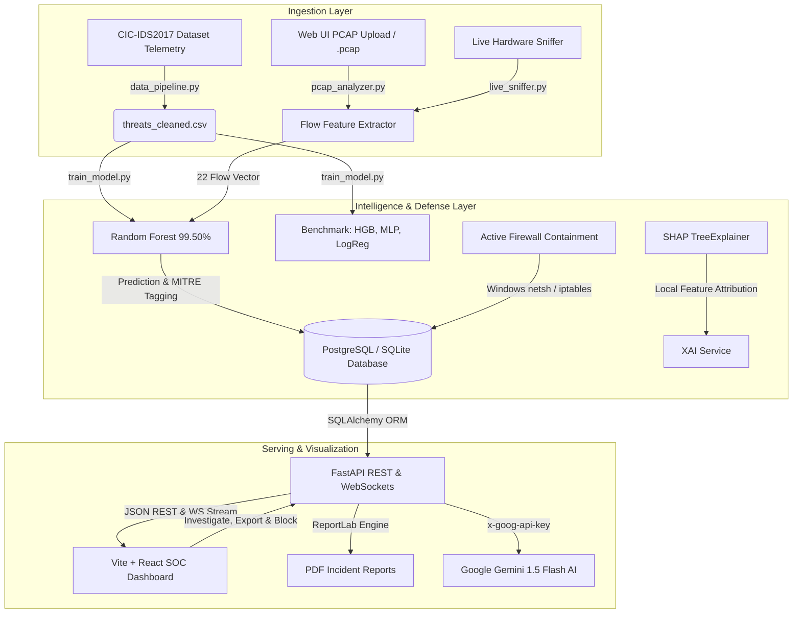

# AI Cyber Threat Detection Platform (SOC Console)
### Final Year Major Project — Enterprise Security Operations Center & Network Telemetry Engine

A full-stack Security Operations Center (SOC) dashboard that monitors real-time and captured network flow telemetry, classifies threats using machine learning trained on the **CIC-IDS2017** benchmark, explains alerts via **Explainable AI (SHAP)** and **Google Gemini Generative AI**, supports **Drag-and-Drop PCAP Ingestion**, provides **1-Click PDF Incident Forensic Reporting**, maps adversaries to the **MITRE ATT&CK** framework, executes **Active Host Firewall Containment**, and streams live alerts via **WebSockets**.

---

## 🚀 Enterprise Feature Highlights

*   **Drag-and-Drop PCAP Ingestion**: Upload any `.pcap` capture directly in the web UI. Our zero-dependency binary packet engine parses raw Ethernet/IP/TCP frames via `struct.unpack`, aggregates bidirectional flows, runs ML inference, and logs threats.
*   **One-Click PDF Forensic Incident Report**: Generate and export formal executive incident reports (`ReportLab` engine) detailing severity ratings, attacker GeoIP, MITRE tags, 22 flow metrics, AI root-cause analysis, and analyst digital audit signatures.
*   **Explainable AI (XAI) via SHAP**: Integrates `shap.TreeExplainer` directly in the threat investigation modal to visualize the mathematical feature contributions (e.g. forward packet inter-arrival times, flag counts, duration) that led the model to its decision.
*   **Multi-Model Academic Benchmark**: Compares 4 distinct model architectures on 2,400 unseen test samples:
    *   **Random Forest** (99.50% Accuracy, 99.37% Macro F1, 16.9 $\mu$s latency) — *Active Deployed*
    *   **Hist Gradient Boosting** (99.50% Accuracy, 99.37% Macro F1, 30.1 $\mu$s latency)
    *   **Multi-Layer Perceptron (MLP)** (99.00% Accuracy, 98.73% Macro F1, 2.9 $\mu$s latency)
    *   **Logistic Regression Baseline** (98.38% Accuracy, 97.90% Macro F1, 0.7 $\mu$s latency)
*   **Real-Time WebSocket Streaming**: Bi-directional event push stream (`/ws/threats`) that displays live alerts and animated banners across connected analyst consoles with zero latency.
*   **Active Containment & Rule Export**: One-click attacker IP isolation with optional host OS execution via Windows `netsh advfirewall`, plus ready-to-deploy rule export for Linux `iptables`, Suricata, and Snort.
*   **Live Hardware Network Sniffer**: Capture live packets directly from the physical machine's network interface (`src/live_sniffer.py`) and stream them into the platform.
*   **Interactive Global Threat Map**: SVG world map plotting adversary geographic coordinates (Ashburn, Frankfurt, Moscow, Beijing, London, etc.) and streaming vector animations towards the protected data center cluster (`10.0.1.10`).

---

## 🛠️ Architecture



---

## 📁 Directory Structure

```
├── backend/
│   ├── app/
│   │   ├── config.py           # Configuration & environment loader
│   │   ├── database.py         # SQLAlchemy engine & session factory
│   │   ├── main.py             # FastAPI REST endpoints, WebSockets, PCAP ingestion
│   │   ├── models.py           # Threat ORM model (GeoIP, MITRE, JSON features)
│   │   ├── schemas.py          # Pydantic validation & response schemas
│   │   ├── report_service.py   # ReportLab PDF Incident Report Generator
│   │   ├── xai_service.py      # SHAP TreeExplainer feature attribution service
│   │   └── ai_service.py       # Google Gemini client with secure headers & fallback
│   ├── scripts/
│   │   └── seed.py             # Database seeder (12,000 CIC-IDS2017 records)
│   └── requirements.txt        # Backend dependencies
├── data/
│   ├── threats_cleaned.csv     # 12,000 synthetic CIC-IDS2017 flow telemetry rows
│   └── live_sample.pcap        # Demonstration raw binary packet capture
├── frontend/
│   ├── src/
│   │   ├── components/         # PcapUploadModal, GlobalThreatMap, ThreatDetailModal, etc.
│   │   ├── pages/              # Overview, Alerts, Analytics, Models, Settings
│   │   ├── App.jsx             # Shell, sidebar, and WebSocket live push listener
│   │   └── main.jsx            # Application entrypoint
│   └── package.json            # Vite + React dependencies
├── ml/
│   ├── model.pkl               # Serialized Random Forest classifier
│   └── metrics.json            # Multi-model comparative benchmark & class reports
├── src/
│   ├── data_pipeline.py        # CIC-IDS2017 flow telemetry generator (22 features)
│   ├── train_model.py          # Multi-model trainer (RF, HGB, MLP, LogReg)
│   ├── predict.py              # Flow inference & risk severity assessment
│   ├── pcap_analyzer.py        # Zero-dependency binary PCAP flow parser
│   ├── live_sniffer.py         # Live physical interface packet sniffer
│   └── simulate_live_traffic.py# Live telemetry feed injector
└── README.md
```

---

## ⚙️ Quick Start Guide

### 1. Prerequisites
- Python 3.10+ (Tested on Python 3.13)
- Node.js 18+

### 2. Environment Configuration
Create a `.env` file in the project root or in `backend/.env`:
```env
# Optional: Set PostgreSQL connection or leave empty to use local SQLite (threats.db)
DATABASE_URL=sqlite:///./threats.db

# Optional: Add Google Gemini API key for live AI explanation generation
GEMINI_API_KEY=your_gemini_api_key_here
```

### 3. Pipeline Setup (Data & Multi-Model Benchmark)
```bash
# 1. Synthesize CIC-IDS2017 flow dataset (12,000 records)
python src/data_pipeline.py

# 2. Run multi-model benchmark training (RF, Gradient Boosting, MLP Neural Net)
python src/train_model.py

# 3. Seed database with incidents, GeoIP coordinates, and MITRE IDs
python backend/scripts/seed.py
```

### 4. Running the Platform

#### Terminal 1 — Backend (FastAPI with WebSockets)
```bash
python -m uvicorn backend.app.main:app --port 8000 --reload
```
*API Swagger Documentation is available at [http://127.0.0.1:8000/docs](http://127.0.0.1:8000/docs).*

#### Terminal 2 — Frontend (React + Vite)
```bash
cd frontend
npm install
npm run dev
```
*Access the SOC Dashboard at [http://localhost:5173/](http://localhost:5173/).*

---

## 🎯 Viva & Evaluator Presentation Workflows

### 1. Web UI Drag-and-Drop PCAP Analysis (The Evaluator Showstopper)
1. Navigate to **Alerts** or **Logs** in the dashboard.
2. Click **"Ingest PCAP Capture"** in the top right.
3. Drop any `.pcap` capture file into the modal, or click **"Analyze Demonstration PCAP (1-Click)"**.
4. Watch the flow parser extract conversational flows and display classified attacks with MITRE technique codes live on screen.

### 2. Explainable AI (SHAP Waterfall) & PDF Export
1. Click on any threat incident in the dashboard.
2. Inside the **Threat Investigation Drawer**:
   - Click **"Calculate SHAP"** under the **Explainable AI** section to show the exact mathematical features pushing the prediction towards attack (red) or benign (green).
   - Click **"PDF Report"** in the header to download a formal, multi-page SOC Incident Report.
   - Click **"Firewall Rules"** to view and copy generated Windows `netsh`, Linux `iptables`, and Suricata IDS rules.

### 3. Multi-Model Thesis Comparison
1. Navigate to **Models (AI)** in the sidebar.
2. Review the **Multi-Model Comparative Benchmark** table comparing Random Forest, Hist Gradient Boosting, MLP Neural Network, and Logistic Regression on accuracy, F1, latency ($\mu$s), and training time.

### 4. Live Hardware Sniffing
Open a terminal and run the live hardware interface sniffer:
```bash
python src/live_sniffer.py --count 10
```
Watch the live alert banner appear automatically in the top header via the WebSocket push connection!
